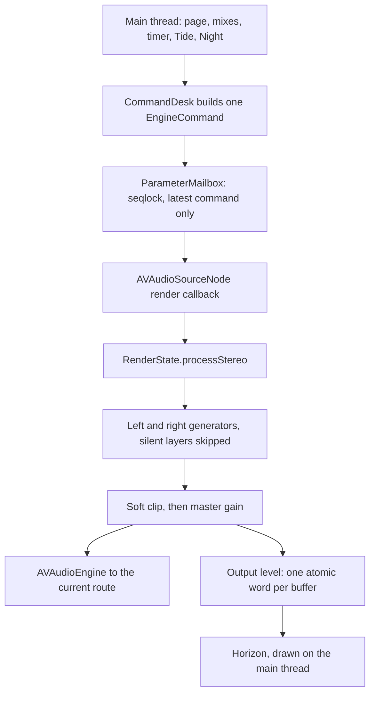

# Architecture

SleepNoise is one iOS app. SwiftUI draws it. `AVAudioEngine` makes the sound. StoreKit 2 sells the single non-consumable. There is no server, no package dependency, and no audio file in the bundle.

The diagram is the path from a finger to a sample. Names match the types in `SleepNoise/Audio`.

## Threads

The main thread is the only writer. It owns the session, the graph, and the mailbox. `SleepAudioEngine` is called from there. Tests of the mixer use a double and never open a session.

The render callback captures raw pointers. It does not capture `self`, allocate, take a lock, or touch a reference-counted object. Once per buffer it copies `RenderState`, runs `processStereo`, and writes the copy back.

`EngineCommand`, `RenderState`, and `BreathParameters` are plain values: floats, integers, and structs of those. The mailbox holds the latest command, not a queue. A fade is a generation counter plus a length in whole samples. `rampSamples < 0` means "leave the fade alone". If the sequence number moves during a read, the callback keeps the command it already had. It does not retry. The fences live in `AtomicBridge.c`.

Rebuilding the graph or adopting a new sample rate does not restart a fade that is already running. `prepare` and a fresh start run only while the engine is stopped. Filter coefficients that need `expf` are computed there, not per sample.

## What a sample is

Each channel owns its own generators, seeded apart, so the noise beds are decorrelated. Their slow movements start in phase, so a swell stays in the centre of the head.

| Sound | Idea in the code |
|---|---|
| White | Uniform noise |
| Pink | Paul Kellet's economy filter, about −3 dB/octave |
| Brown | Leaky integrator |
| Rain | A high-passed hiss, a soft low body, and five overlapping droplet voices |
| Fan | A resonant whoosh, a quiet motor hum, and a shallow blade flutter |
| Ocean | Low rumble, two swells that do not share a period, and a surf band |
| Thunder | A schedule of rumbles, offset once per launch |
| Campfire, brook, wind, cabin | Each a small generator of its own, with `prepare` and `next` |

A gain that has settled below `1e-4` skips that generator. The sum is soft-clipped, then multiplied by the master gain. The master is the session level: Blanket, the vertical axis of Night, and the cap after headphones disappear. It is applied after the clip, so turning the night down changes loudness and not the tone. It never writes the system volume.

NaNs become silence. Denormals are flushed. The callback stores the mean square of what it just output. The main thread smooths that word into the Horizon. The line is the level now, not a history.

## Session

`AVAudioSession` category is `.playback`, with the `audio` background mode. Playback continues with the screen locked and ignores the Ring/Silent switch. The engine uses the route's sample rate.

Unplugging headphones pauses playback. The app does not resume by itself onto the built-in speaker.

A phone call pauses playback. Outside the morning window the night resumes when the call ends, with a three-second fade. Inside the morning window the night ends, and a call ends it too. That window is 05:00 until 11:00, or the hour before a Blanket's fixed end, which replaces the 05:00–11:00 rule rather than adding to it. Any other interruption that keeps the night paused for twenty minutes ends it. `CallKit` is used only to tell a live call from any other interruption. The observer does not read who is calling.

When playback stops, the session is deactivated without telling other apps to resume.

## Around the engine

`AccessPolicy` decides who may hear a sound, save another mix, or run the Tide. `SaleGate` and `NightWindow` close every path to the Pro sheet from 21:00 to 07:00, and for as long as the night page is up. `NightTrial` is pure date arithmetic over a record in the Keychain. `LayerCap` picks the six loudest included layers. `MixCodec` reads and writes format v2, and still reads v1.

Saved mixes and the last levels live in `UserDefaults` on the device. The app has no `URLSession`.

The five Shortcuts call the same mixer as the screen. They cannot start the trial and they cannot open a purchase.

StoreKit sits behind `ProStore`. The shipping store is `AppStoreProStore`. Tests use `ScriptedProStore` and never talk to Apple. The scheme's Run action loads `SleepNoise.storekit` so a run from Xcode uses a local store.

## Tests

`scripts/verify.sh` regenerates the project, builds clean, builds the Release configuration that ships, and runs the unit tests. It fails on a compiler or App Intents warning outside a short allow-list, on a skipped test, and when fewer than 700 tests run. Spectral checks for the coloured noise live next to the generator tests. CI is the job `verify` in `.github/workflows/ci.yml`, on the `macos-26` image, with Xcode 26.6.

## Known limit of the generators

`XorShift32` keeps a 32-bit state. Its sequence repeats after `2^32 − 1` samples, which is about 24 hours and 51 minutes at 48 kHz. The seeds in `RenderState` are constants. Only the thunder schedule is chosen at launch, so each launch of the app starts the other generators from the same sample. There is no recorded loop in the app, and there is also no test yet that a long render never resembles itself. The store drafts say so, and they keep a fallback sentence that claims only what the code supports: no audio files, and no loops of recordings.
